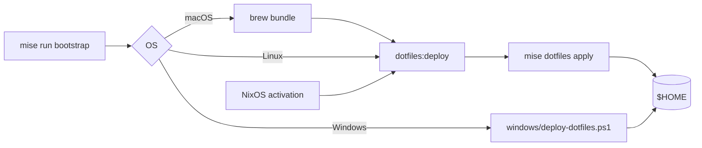

<div align="center">


# dotfiles

**One zsh, one git, one agent brain, on every machine I touch.**

[](https://github.com/jonpulsifer/dotfiles/actions/workflows/dotfiles.yml)


</div>

---

## ⚡ Install

<table>
<tr><th>macOS · Linux</th><th>Windows</th></tr>
<tr><td>

```bash
curl https://mise.run | sh
git clone https://github.com/jonpulsifer/dotfiles \
  ~/src/github.com/jonpulsifer/dotfiles
cd ~/src/github.com/jonpulsifer/dotfiles
mise trust -y mise.toml
mise run bootstrap
```

</td><td>

```powershell
irm https://raw.githubusercontent.com/jonpulsifer/dotfiles/main/windows/bootstrap.ps1 | iex
```

With WSL and a NixOS distro:

```powershell
& ([scriptblock]::Create((irm https://raw.githubusercontent.com/jonpulsifer/dotfiles/main/windows/bootstrap.ps1))) -WithWsl
```

</td></tr>
</table>

> [!TIP]
> On macOS, install [Homebrew](https://brew.sh/) first and `bootstrap` installs the `Brewfile` too.
> NixOS hosts need nothing: every activation applies these dotfiles on its own.

## 🎭 Profiles

Set `MISE_ENV` before `bootstrap` to pick what a machine gets. Combine them with commas.

| `MISE_ENV` | Machine | Adds | Leaves out |
| --- | --- | --- | --- |
| *(unset)* | personal | the base set | |
| `lab` | operates the homelab | `~/.ssh/config.lab`, `~/.agents/AGENTS.lab.md` | |
| `work` | the work laptop | | homelab tools, personal Brewfile entries, the WSL signing key |

Work repos get the work git identity on every machine, whatever the profile.

## 🧰 What you get

| | |
| --- | --- |
| 🐚 **zsh** | [pure](https://github.com/sindresorhus/pure), autosuggestions, syntax highlighting, fzf-tab and kube-ps1. One `.zshrc` everywhere: mise installs the plugins, and home-manager does on NixOS. |
| ✏️ **vim** | A plugin-free `.vimrc` with syntax highlighting and a built-in colorscheme, for a quick edit over SSH. |
| 🌿 **git** | SSH commit signing through 1Password, and a separate identity in work repos. |
| 🖥️ **terminal** | tmux and Ghostty. |
| 🔐 **ssh · gpg** | Client config, plus the lab hosts on `lab` machines. |
| 🤖 **agents** | One `AGENTS.md` for Claude Code, Codex, Gemini, pi and opencode, shared skills, a Claude status line and the `mate` pi package. |
| 🛠️ **tools** | mise for runtimes, Kubernetes and agent CLIs. Homebrew on macOS, home-manager on NixOS, WinGet on Windows. |

## 🔁 How it works



- The `[dotfiles]` table in `mise.toml` links every file into `$HOME`. Links point into the checkout you run from, so run from the main checkout, never a worktree.
- `mise dotfiles apply` never replaces a real file. Read-only copies and directory links from older deploys move to `~/.dotfiles-backup/`. Anything else in the way stops the deploy and is named: move it aside and run again. Never pass `--force`.
- NixOS activation runs `dotfiles:deploy` from a store copy of this repo, which the infra repo takes as a flake input.
- Windows keeps its own clone, and no link crosses into WSL. See [Install a Windows desktop](https://wiki.lolwtf.ca/runbooks/install-a-windows-desktop/).

## 🗂️ Layout

```text
.
├── mise.toml               the [dotfiles] table and the tasks
├── mise/
│   ├── global.toml         → ~/.config/mise/config.toml
│   └── global.work.toml    → ~/.config/mise/config.work.toml, read only under MISE_ENV=work
├── Brewfile                macOS packages
├── .zshenv, .config/zsh/   zsh
├── .vimrc, .tmux.conf
├── .config/git/            git config, the work overlay, the WSL signing template
├── .config/ghostty/
├── .ssh/, .gnupg/
├── .local/bin/             scripts
├── .agents/                AGENTS.md for every agent CLI
├── .claude/                status line and settings seed
├── skills/                 → ~/.agents, ~/.claude and ~/.gemini skills
├── pi/                     the mate pi package
└── windows/                installer, winget configuration, PowerShell profile
```

## 🧩 By hand

- **Claude Code** writes to `~/.claude/settings.json`, so `.claude/settings.json` is only a seed: copy it there once. On `lab` machines, merge in the lab's `autoMode`:
  ```bash
  jq --slurpfile lab .claude/settings.lab.json '.autoMode = $lab[0].autoMode' ~/.claude/settings.json
  ```
- **pi**: `mise run pi:setup` loads the `mate` package from `~/.dotfiles/pi/mate` and seeds pi's settings. Linux and macOS only.

## ✅ Test

```bash
mise run dotfiles:check   # deploys into scratch homes under every profile; touches nothing in $HOME
```

CI runs the same check, plus shellcheck on `.local/bin` and PSScriptAnalyzer on `windows/`, with mise 2026.10.0, the release the NixOS hosts pin.
